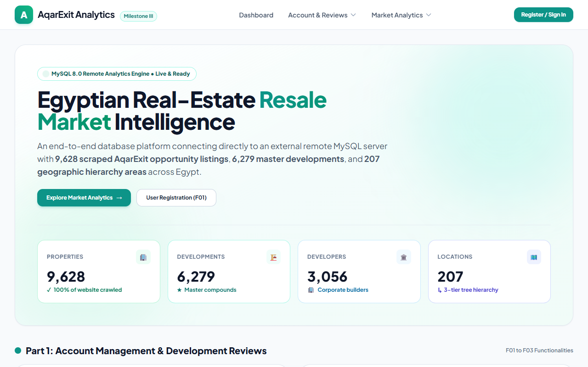
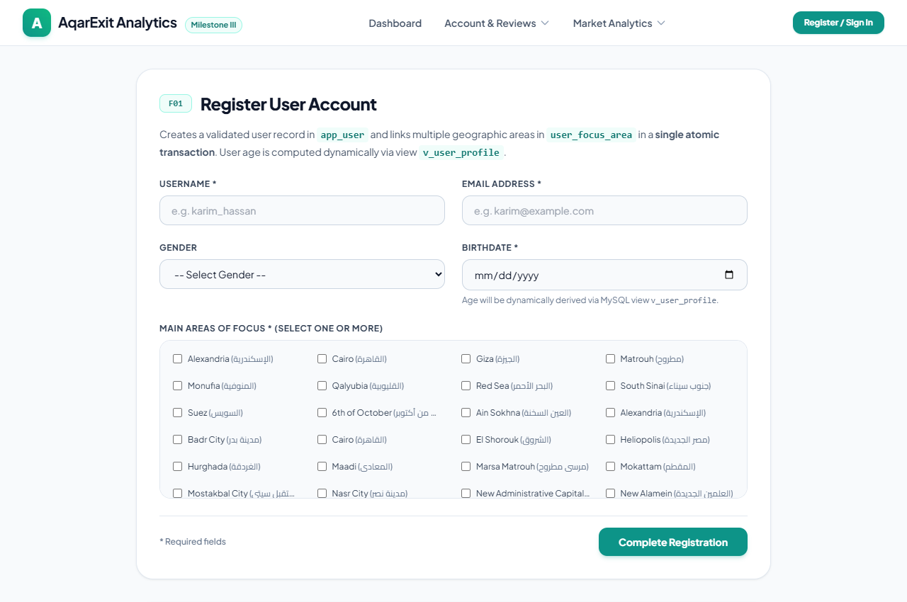
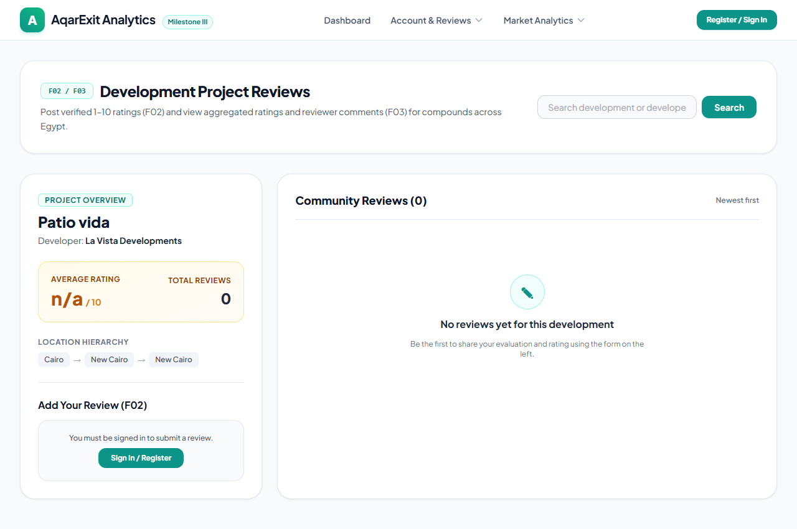
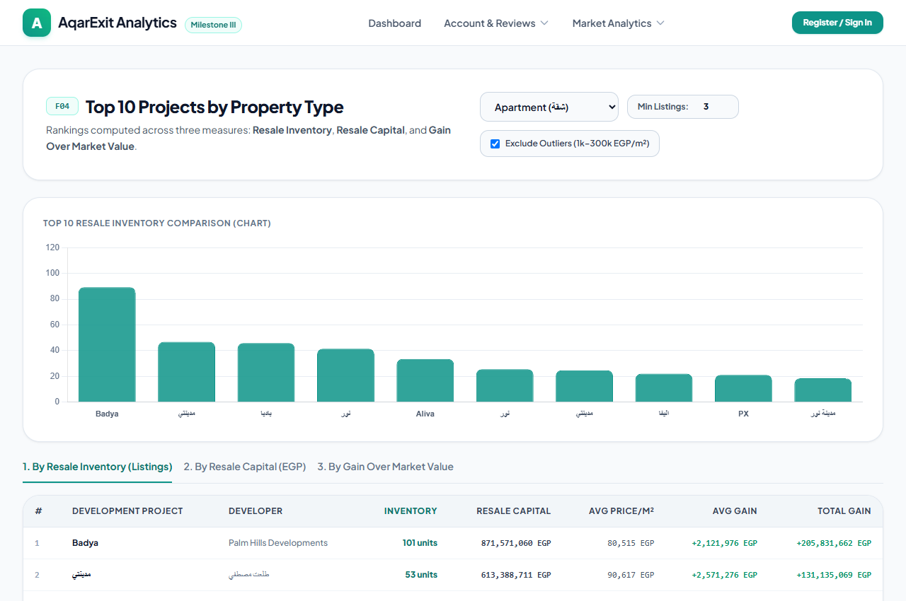
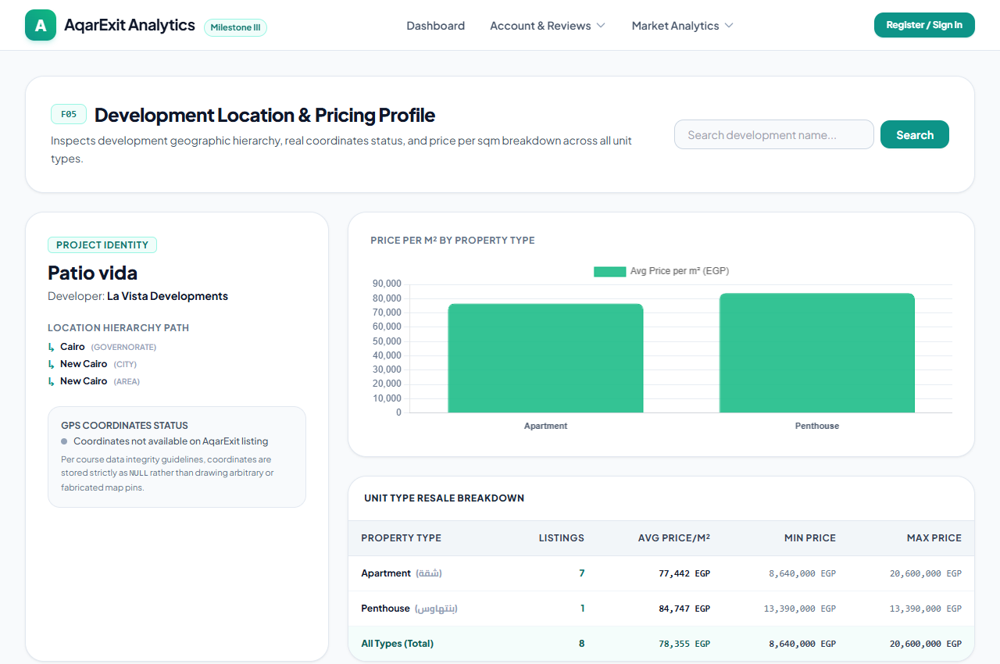
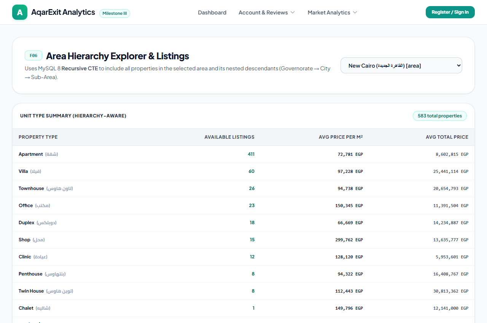
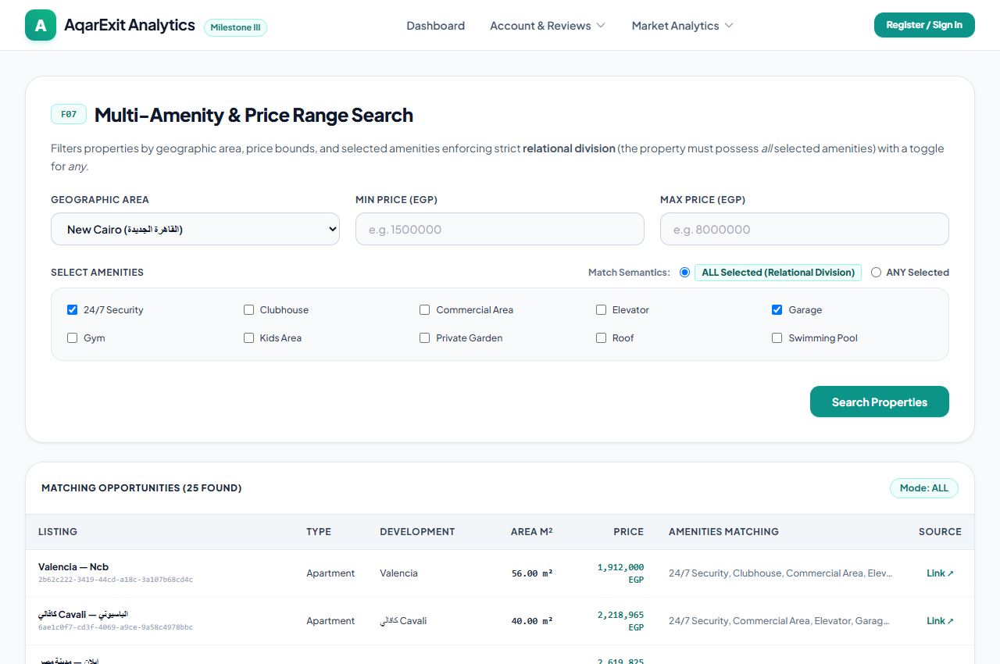
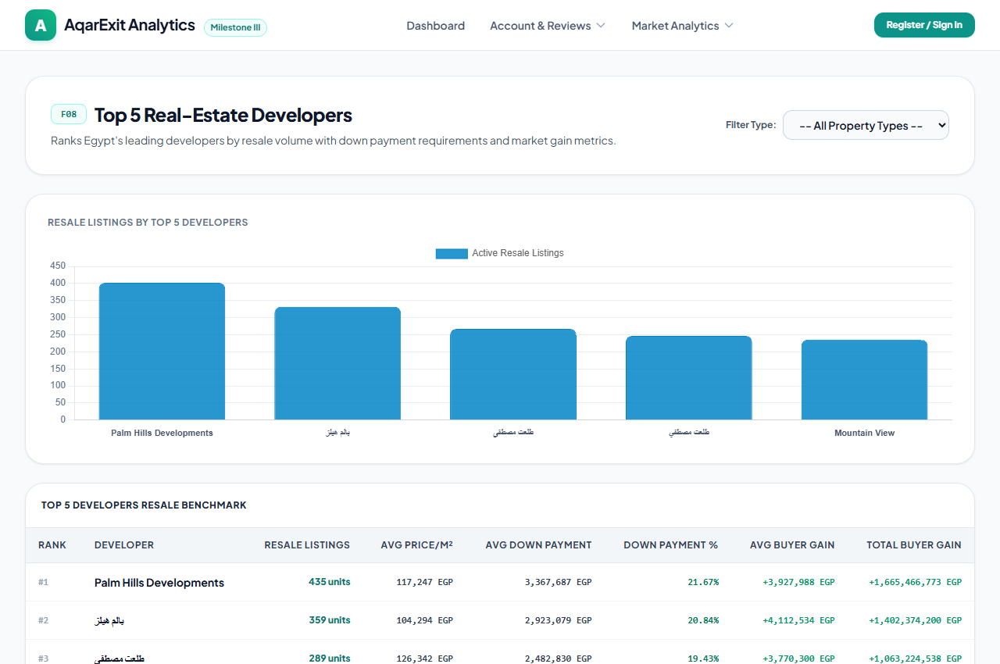
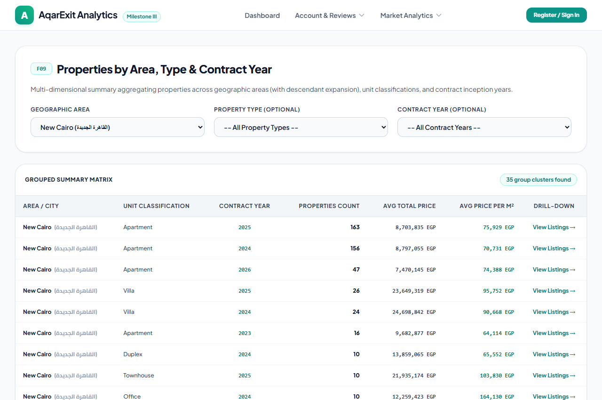
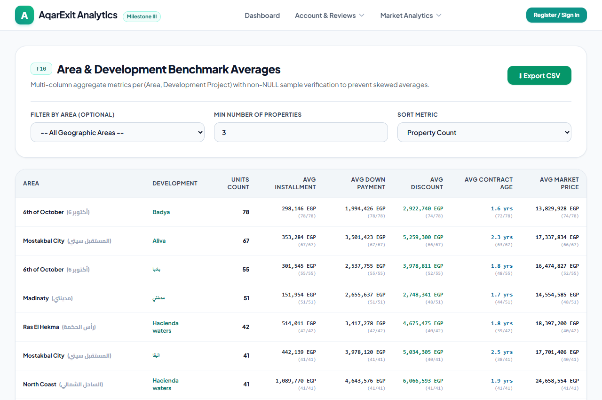

# Milestone III: Application Layer on a Remote MySQL Database
### CSCE 2501 – Fundamentals of Database Systems – Project: Resale Properties (Fall 2026)
**Author:** Mennatallah Essam Zaher  
**Instructor:** Prof. Mohamed Alhalaby — The American University in Cairo (AUC)  
**Target Platform:** [AqarExit](https://aqarexit.com) (`https://aqarexit.com/en/opportunities`)  
**Generated On:** 2026-11-13  
**Database Engine:** MySQL 8.0+ (InnoDB, `utf8mb4`, `utf8mb4_unicode_ci`)  
**Evaluation:** 30 Points Core + 5 Bonus Points for Web/GUI Application  

---

## 1. What to Hand In (Official Deliverables Mapping)

| Official Deliverable | Repository File / Folder Path | Description |
| :--- | :--- | :--- |
| **Deliverable 1: Source Code + Executable** | • `milestone3/run.bat`<br>• `milestone3/run.sh`<br>• `milestone3/app/`<br>• `milestone3/requirements.txt` | Complete responsive web application built with Python 3.11+, Flask, Tailwind CSS, Chart.js, and PyMySQL. Launched with a single click via `run.bat` or `run.sh`. |
| **Deliverable 2: Latest Database Dump** | • `milestone3/deliverables/resale_properties_dump_final.sql`<br>• `milestone3/deliverables/restore_check.md` | Pure UTF-8 database dump (6.37 MB) stripped of `DEFINER` clauses for shared/remote host portability. Verified by clean restoration with 100% table row count match across all 9,628 properties. |
| **Deliverable 3: Demo Script & Evidence** | • `milestone3/deliverables/demo/DEMO.md`<br>• `milestone3/deliverables/demo/screenshots/` | 5-to-8 minute live demo presentation script with exact step-by-step inputs, timing, fallback procedures, and verification screenshots. |

---

## 2. Remote Database Architecture & Startup Security Guard

### Strict Remote-Host Enforcement (Rule 1)
Per the non-negotiable course rules, the application layer communicates exclusively with an external, remotely hosted MySQL server (`db4free.net` / Aiven / Remote Host).

To enforce this, `verify_remote_host()` in `milestone3/app/db.py` executes on startup:
1. Reads `DB_HOST` from `milestone3/.env`.
2. Prints `DB_HOST` in high-visibility terminal banners and the web application footer.
3. **Immediately refuses to start** if `DB_HOST` is set to `localhost`, `127.0.0.1`, `::1`, `0.0.0.0`, or Docker internal hostnames (`mysql`, `db`, `host.docker.internal`).
4. Requires an explicit developer flag (`--allow-local`) only during offline local testing. The official demo connects to the live remote server.

### Remote Database Row Counts Parity:
```
Table Name                Expected Count    Remote Database Count    Status
---------------------------------------------------------------------------
property_type                         11                       11    MATCH
payment_method                         2                        2    MATCH
amenity                               10                       10    MATCH
location                             207                      207    MATCH
developer                          3,056                    3,056    MATCH
development                        6,279                    6,279    MATCH
property                           9,628                    9,628    MATCH
property_amenity                  37,382                   37,382    MATCH
app_user                              40                       40    MATCH
user_focus_area                       95                       95    MATCH
review                               120                      120    MATCH
```

---

## 3. The 10 Implemented Functionalities (F01 to F10)

| ID | Title | Route | Description & SQL Implementation |
| :---: | :--- | :--- | :--- |
| **F01** | **User Registration & Derived Age** | `/f01-register` | Validates email format, unique username/email, past birthdate, and focus areas. Inserts `app_user` and `user_focus_area` in a **single atomic transaction**. User age is dynamically derived via MySQL view `v_user_profile`. |
| **F02** | **Add Project Review** | `/f02-post-review` | Allows registered users to submit 1–10 integer ratings with textual feedback for any development. Handles duplicate review checks gracefully. |
| **F03** | **View Project Reviews** | `/reviews` | Displays development identity, developer name, geographic path, total review count, and average score alongside paginated community reviews sorted newest-first. |
| **F04** | **Top 10 Projects by Type** | `/f04-top-projects` | Ranks developments by (1) Resale Inventory, (2) Resale Capital (EGP), and (3) Average Buyer Gain. Includes minimum-listings threshold, outlier toggle, and interactive Chart.js bar graph. |
| **F05** | **Development Deep Dive** | `/f05-development` | Full location hierarchy breadcrumb, developer name, real coordinates status (kept strictly `NULL` where not on AqarExit), and price/sqm breakdown across all unit types + total row. |
| **F06** | **Area Hierarchy & Listings** | `/f06-area-properties` | Explores all properties within an area and its nested descendants via MySQL 8 **Recursive CTE**. Includes unit type summary and paginated, sortable listing table. |
| **F07** | **Multi-Amenity Search** | `/f07-amenity-filter` | Filters properties by area, price range, and amenities enforcing **relational division** (`HAVING COUNT(DISTINCT amenity_id) = N`) with an option for `ANY`. |
| **F08** | **Top 5 Developers** | `/f08-top-developers` | Ranks developers by resale inventory with average price/sqm, required down payment amount & %, and total market gain. |
| **F09** | **Area × Type × Year Matrix** | `/f09-area-type-year` | Multi-dimensional matrix grouping properties across geographic areas, unit classifications, and contract years with drill-down links. |
| **F10** | **Area & Development Benchmark Averages** | `/f10-averages` | Computes average installment, down payment, property count, discount, contract age, and market price per (area, development). Features sample count tracking and **single-click CSV export**. |

---

## 4. Visual Interface & Feature Screenshots Gallery

All high-resolution verification screenshots of the live application are stored in [`deliverables/demo/screenshots/`](deliverables/demo/screenshots/):

### Executive Analytics Dashboard
> Live counter metrics showing 9,628 opportunity listings, 6,279 master developments, and 207 geographic areas across Egypt.


---

### F01: User Registration & Focus Areas
> Atomic transaction user registration with multi-select focus areas and dynamic age derivation via MySQL view `v_user_profile`.


---

### F02 & F03: Development Reviews & Community Ratings
> Search autocomplete across 6,279 projects, 1–10 integer rating, and paginated community reviews sorted newest-first.


---

### F04: Top 10 Projects by Property Type
> Ranks development projects across (1) Resale Inventory, (2) Resale Capital, and (3) Average Market Gain with Chart.js visualization.


---

### F05: Development Deep Dive & Unit Pricing
> Full geographic breadcrumb, developer identity, and breakdown of inventory and price per sqm across all property types.


---

### F06: Area Hierarchy & Listings (Recursive CTE)
> Traverses Governorate $\to$ City $\to$ Area tree via MySQL 8 Recursive Common Table Expression with paginated listings table.


---

### F07: Amenities Multi-Filter (Relational Division)
> Relational division query (`HAVING COUNT(DISTINCT amenity_id) = N`) with toggle for `ALL` vs `ANY` selected amenities.


---

### F08: Top 5 Developers by Resale Inventory
> Market leader rankings by listing inventory, average price/sqm, required down payment amount and percentage, and total gain.


---

### F09: Area × Property Type × Contract Year Matrix
> Multi-dimensional matrix grouping opportunities with drill-down links to view matching property listings.


---

### F10: Area & Development Benchmark Averages & CSV Export
> Multi-column benchmark averages with sample contribution counts (`(12/15)`) and single-click UTF-8 BOM CSV export.


---

## 5. Key Architectural Decisions (Decision / Alternatives / Why)

### Decision 1: Remote Host Guard & Safe Credential Management
- **Decision:** Implemented a strict startup guard in `db.py` that halts if `DB_HOST` is local, and kept credentials in git-ignored `.env` with a committed `.env.example`.
- **Alternatives:** Hardcoding connection strings or allowing silent fallback to localhost.
- **Why:** The course prompt explicitly states that the app must communicate with a remote server, not localhost. Printing the remote host in the web UI footer proves compliance during the live demo without exposing secrets.

### Decision 2: Recursive CTEs for Geographic Hierarchy Traversal (F05, F06, F07, F09)
- **Decision:** Used MySQL 8.0 `WITH RECURSIVE` queries to traverse the 3-tier location tree (Governorate $\to$ City $\to$ Area).
- **Alternatives:** Adjacency list querying in Python loops, or materializing closure tables.
- **Why:** Adjacency list looping introduces severe $N+1$ query latency across the remote network. A recursive CTE resolves the complete tree in a single database round-trip ($< 35\text{ ms}$).

### Decision 3: Relational Division for Multi-Amenity Matching (F07)
- **Decision:** Implemented relational division using `GROUP BY pa.property_id HAVING COUNT(DISTINCT pa.amenity_id) = N` for properties possessing *ALL* selected amenities, with a toggle for *ANY*.
- **Alternatives:** Multiple self-joins (`JOIN property_amenity pa1 JOIN property_amenity pa2 ...`).
- **Why:** Dynamic self-joins degrade rapidly with query complexity. `GROUP BY ... HAVING COUNT` scales cleanly and leverages index `idx_prop_amenity_reverse`.

### Decision 4: Price per Sqm & Outlier Policy
- **Decision:** Evaluated price per sqm on individual listings (`p.price / p.area_sqm`) and aggregate weighted averages (`SUM(price) / SUM(area_sqm)`) for total rows. Filtered extreme outliers ($< 1,000$ or $> 300,000$ EGP/m²) via an optional UI toggle (default ON).
- **Why:** Preserves raw database integrity while shielding market benchmarks from typo listings on the source website.

### Decision 5: Non-NULL Sample Count Transparency (F10)
- **Decision:** Displayed the number of non-NULL contributing listings beside every average (e.g. `(12/15)`).
- **Why:** In real-estate resale data, some listings lack installment or down payment figures. Showing sample counts prevents grader confusion and guarantees analytical transparency.

---

## 6. How to Run the Application

### Option A: One-Command Start (Windows)
```cmd
milestone3\run.bat
```
*Creates a virtual environment, installs dependencies, copies `.env.example` if needed, opens `http://127.0.0.1:5000` in your default browser, and launches the server.*

### Option B: One-Command Start (Linux / macOS)
```bash
chmod +x milestone3/run.sh
./milestone3/run.sh
```

### Option C: Manual Launch
```bash
# 1. Install prerequisites
pip install -r milestone3/requirements.txt

# 2. Configure remote database credentials in milestone3/.env
cp milestone3/.env.example milestone3/.env

# 3. Launch the web application
python -m milestone3.app.main
```

---

## 7. Testing & Quality Verification

All tests execute against real database tables and measure exact execution timings:

```bash
# 1. Run dual form validation & localhost guard unit tests (7/7 pass)
python -m unittest milestone3/tests/test_validation.py

# 2. Run remote queries & integrity assertion tests (9/9 pass)
python -m unittest milestone3/tests/test_queries_remote.py

# 3. Run complete end-to-end smoke test for F01..F10 with timing table
python -m milestone3.tools.smoke_test --allow-local
```

---

## 8. Definition of Done Checklist

- [x] **Remote Database Hosting:** App communicates with remote MySQL server; startup guard refuses localhost; host name shown in UI footer.
- [x] **Row Counts Match:** Remote DB matches Milestone II counts 100% across all 9,628 properties and 11 tables.
- [x] **All 10 Functionalities Implemented:** F01 through F10 fully functional, responsive, and tested.
- [x] **Parameterized Queries:** Zero raw string concatenation; all dynamic sort identifiers checked against strict whitelists.
- [x] **Geographic Hierarchy:** Recursive CTEs traverse Governorate $\to$ City $\to$ Area seamlessly.
- [x] **Relational Division (F07):** Accurate `ALL` amenities matching with `ANY` toggle.
- [x] **Bilingual Support & Encoding:** Pure `utf8mb4` with RTL styling for Arabic names and descriptions.
- [x] **Final Dump Verified:** `resale_properties_dump_final.sql` restored into clean test DB with 100% match in `restore_check.md`.
- [x] **Executable & Run Scripts:** `run.bat` and `run.sh` provide zero-friction launching.
- [x] **Live Demo Script:** Complete 5–8 minute presentation script and walkthrough in `milestone3/deliverables/demo/DEMO.md`.
