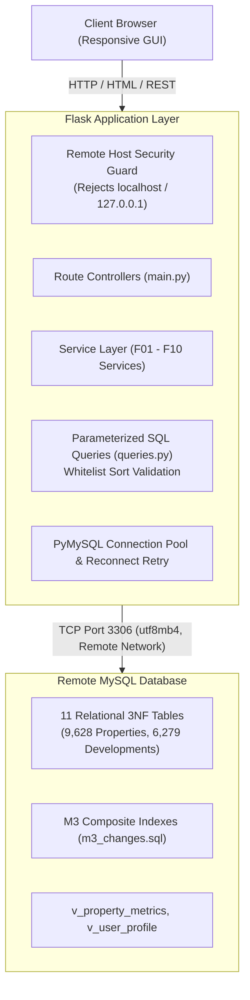
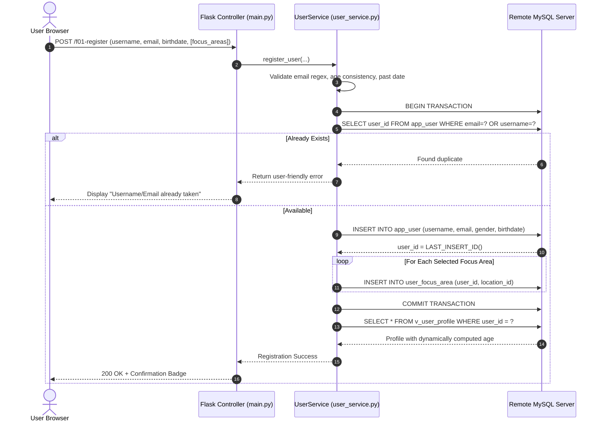

# Milestone III: System Architecture & Data Flow
### CSCE 2501 – Fundamentals of Database Systems – Project: Resale Properties
**Author:** Mennatallah Essam Zaher  
**Instructor:** Prof. Mohamed Alhalaby — The American University in Cairo (AUC)  

---

## 1. High-Level Architecture Overview

The Milestone III application layer is a full-stack, decoupled, database-first web system built in **Python 3.11+ / Flask**, serving a high-performance responsive UI styled with **Tailwind CSS** and dynamic charts via **Chart.js**.

---

## 2. Request / Response Lifecycle

1. **Startup Host Enforcement:**
   When the Flask application starts, `verify_remote_host()` in `milestone3/app/db.py` inspects `DB_HOST`. If it resolves to `localhost`, `127.0.0.1`, `::1`, or Docker internal hostnames, the application **immediately halts with a fatal exception**, ensuring absolute compliance with course requirements.
2. **Client Request:**
   The user navigates the web application or submits an analytical query (e.g., F06 Area Hierarchy or F07 Multi-Amenity Search).
3. **Dual Validation & Whitelist Sanitization:**
   - User inputs (dates, ratings, IDs) are validated server-side.
   - Dynamic parameters (e.g. `ORDER BY price DESC`) are checked against strict hardcoded whitelists in `ALLOWED_SORT_COLUMNS` to prevent SQL injection.
4. **Parameterized Query Execution:**
   The query is executed over the remote network connection via `PyMySQL` with `autocommit=False`, parameterized arguments (`%s`), and automatic retry on network drops.
5. **View Rendering:**
   Data is transformed into Jinja2 templates, numbers formatted with thousand separators, and rendered with RTL Arabic font support.

---

## 3. Transaction Flow: F01 User Registration

